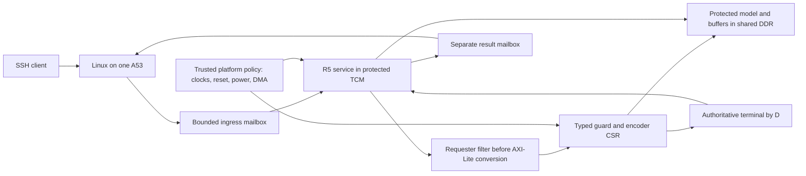

# Keeping Linux/SSH alive while R5 owns typed inference

2026-10-16. **Feasible architecture; not supported by the current candidate and
not yet a hardware-verified guarantee.** Investigation only: no target contact,
RTL/firmware edits, FPGA/toolchain build, new image, programming or deployment.
All 8,204 previously sealed repository files were verified before this work and
are checked again in its final validation seal. Existing numerical/model,
qualified encoder, routed typed and dedicated boot-chain baselines remain frozen.

## Decision and precise guarantee

Keep Linux, networking and SSH on A53_0 as the management plane; run the exact
integer inference/head service on R5_0, with authoritative admission and terminal
publication in PL. Limit Linux to one A53 initially to reduce interference and
make experiments easier to interpret. This is an engineering workload limit,
not memory, device or temporal isolation. Other A53s must have known inactive
states; pinning `sshd` alone does not stop other kernel threads or DMA.

The strongest near-term claim is the existing **local typed terminal deadline**:
after a valid PL admission at edge `a` with budget `D>0`, a matching terminal
record exists by edge `a+D`, assuming the guard clock/reset remain valid and
its authoritative inputs/state are protected. Missing encoder/R5 progress can
produce `Deadline`, with an empty label payload. Successful inference is a
separate guarantee and is not established by the timeout mechanism.

| Claim | With A53 Linux active? | Required evidence |
|---|---|---|
| Accepted/Clarify/Abstain/Fault/Deadline/Invalid are finite typed outcomes; only Accepted carries a label | Yes, by design under trusted proposal and immutable numerical inputs | Existing logical invariants plus new access-control, mailbox and system composition proofs |
| Local PL terminal by D after admission | Architecturally yes despite unbounded DDR/ARM delay | Continuous guard clock/reset, unauthorized writes blocked, routed timing and composed proof |
| Accepted classification by D for every eligible request | Not currently established | Bounded DDR/control service, R5 copy/head/proposal execution, drain and admission assumptions |
| Acknowledging an SSH request, before PL admission, by D | No | Linux scheduler, validation/queueing and network are outside this clocked contract |
| Result delivered to SSH client by D | No standard SSH/Linux hard bound | Separate end-to-end transport design/contract; report measurements as measurements |
| Linux cannot corrupt inference/control state | Not with the present hardware | Enforcement for A53, GEM/DMA, management APIs and configuration paths |
| SSH remains usable through every PL/system fault | Not guaranteed | Ordinary coexistence does not replace independent recovery for first trials |

At a calibrated minimum uninterrupted guard frequency `f_min`, `D/f_min` bounds
the admission-to-terminal interval in seconds. The declared nominal 200 MHz
alone is not oscillator calibration. Admission edge age is zero; a valid matching
proposal at D wins according to the frozen contract. Neither DDR wait time nor
Linux/R5 scheduling extends the counter. An ownership failure does not imply
the current RTL instantly emits Fault; absent a valid earlier proposal it can
reach Deadline. Reset or a stopped guard clock invalidates these assumptions.

The freeze-preserving opportunity is important: DDR interference may reduce the
Accepted rate without defeating the typed terminal deadline. We must measure
both; a system which always times out is not a useful inference MVP.

## Actual local implementation findings

Machine evidence: `build/v2/typed200-amp-feasibility-v1/source-audit.json`.
Source locations and hashes are recorded there; this section is based on actual
code/metadata rather than an assumed Zynq block diagram.

1. `firmware/typed200_mvp/ownership.c` requires A53 reset mask `0xf` and GEM reset
   mask `0xf`. `platform.c` waits for all four A53 resets and validates the
   full ownership table before admission. It parks after one preloaded command.
   Its manifest explicitly says concurrent A53/Linux is unsupported. Removing
   those tests alone discards the premise behind its exclusivity argument.
2. `firmware/typed200_k26_boot/pmu_seal.c` blocks every ordinary IPI after its
   one-way seal and suppresses normal module events/scheduled callbacks, keeping
   EM safety dispatch. That policy was designed for no Linux. It is not a
   tested Linux-compatible allowlist for network, storage and power services.
3. The actual typed HWH connects PS `M_AXI_HPM0_FPD` to `control_interconnect`,
   then to encoder CSR `a0000000..a0000fff` and deployment-permit GPIO
   `a0001000..a0001fff`. Encoder memory uses `S_AXI_HP0_FPD`, 128 bits, into
   shared PS DDR. This is allocation on one SoC, not a private R5 memory fabric.
4. The control SmartConnect input is full AXI4 with **16-bit AWUSER/ARUSER**.
   Both output interfaces are AXI4-Lite with **zero USER bits**. The actual
   `rtl/platform/typed200/typed200_encoder_wrapper.v` has no requester-ID, USER
   or PROT inputs. The endpoint cannot distinguish an R5 write from an A53
   write arriving at its address. Upstream PROT metadata also does not help
   unless a trusted component actually checks it before it is discarded.
5. The same HWH has `PSU__ENET0..3__PERIPHERAL__ENABLE=0`. The dedicated standalone
   PS initialization exported from it is not a complete Linux/network boot
   configuration. This does **not** mean loading the PL-only bitstream under
   the existing stock Linux setup disables Ethernet: applying PS initialization
   is a separate action. A new AMP cold boot must use a compatible board PS
   configuration with the actual wired GEM, PHY/MDIO, MIO, clocks and boot devices.
6. The final row-range-carry-save publication-gate logic matches the previously
   proved gate source after comments/whitespace removal. The audited existing
   invariant receipt is `build/v2/typed-formal-gate-final-v5/receipt.json`.
   Its elapsed/terminal recurrence has no DDR or AXI-response enable. This is
   existing RTL-step evidence, not a new proof of Linux isolation or physical timing.
7. Guard success trusts the R5 proposal after matching epoch/completion/drain.
   It does not recompute the classifier label. A Linux writer could forge a
   matching proposal after real encoder completion, or ACK a successful record
   before R5 observes it. Session/request matching is not caller authentication.
8. R5 reads up to `128*384=49,152` hidden bytes from DDR before its head step.
   Its program/stack are TCM-based, but this copy, PL model reads/result writes
   and control transactions still traverse shared resources. The startup model
   hash cannot prevent later Linux/DMA writes; continuous protection is required.
9. The frozen Linux overlay deliberately exposes a host-polled control aperture,
   assigned clocks and FPGA/AFI resets. It already warns that reservations belong
   in the boot DTB. It must not be used unchanged as an exclusive-owner AMP profile.

The positive result is not a drop-in firmware switch. It is a new environment
and independently qualified candidate with the same numerical payload possible.

## Proposed system boundary

This is a proposed architecture, not a synthesized design. No diagram edge
implies a physical service bound. DDR remains shared even with disjoint addresses.

### PL control and platform ownership

Place a requester-aware access filter before the present AXI4-to-Lite conversion,
where PS source metadata is still available. Protect **both** typed CSR and
permit, plus filter configuration, reset and bypass controls. R5 is the sole
runtime writer of session, START, proposals, ACK and permit. Linux gets a separate
mailbox/status interface, not a mapping of these registers. Reject unauthorized
accesses with bounded protocol-compliant error responses; do not leave an A53
transaction hanging or forward a partial write. Full AXI AW/W decoupling,
WSTRB, bursts, outstanding transactions, reset and partial-frame cases need proof.
If reusing XMPU_PL, verify exact bit extraction/masks from PS AxUSER for this
generated design; transaction AXI ID is not a substitute for origin identity.
Changing to a different PS-PL port alone is not an authorization mechanism.

AMD's [XAPP1353 summary](https://docs.amd.com/r/en-US/xapp1353-pl-isolation/Summary)
provides the PL protection extension. Its
[SmartConnect guidance](https://docs.amd.com/r/en-US/xapp1353-pl-isolation/AXI-SmartConnect)
requires preserving AxUSER through full AXI to the checker. The
[master-ID description](https://docs.amd.com/r/en-US/xapp1353-pl-isolation/Master-IDs)
and [configuration protection](https://docs.amd.com/r/en-US/xapp1353-pl-isolation/Isolating-the-XMPU_PL-Configuration)
are directly relevant. The reference targets ZCU102, not a prequalified KR260
drop-in. Our archive download attempt returned AMD Customer Community HTML;
the VHDL/reference archive was **not obtained or audited**. Its documentation is
evidence for a mechanism, not verification of an available IP implementation.

Build a **selective** platform ownership policy, replacing neither frozen policy
in place. During active service deny Linux-origin requests affecting RPU/TCM,
PL clock/reset, critical parent PLLs, DDR timing/controller configuration,
AFI, protection configuration and CSU/FPGA load/readback. Cover API/resource/
argument aliases, generic MMIO/IOCTL and direct MMIO routes, plus PSCI/system
reset paths in trusted firmware. Allow only reviewed Linux-private leaf
operations needed by the chosen network/storage stack. Preserve K26 thermal/
board shutdown; emergencies invalidate the run. Read-only APIs also require
cost/side-effect review and rate limits if on a shared control path.

Installed 2025.2 `pm_core.c` checks clock/reset/MMIO permissions through different
paths; a denylist of a few API numbers is insufficient. Linux's pinned
[firmware PM wrappers](https://github.com/Xilinx/linux-xlnx/blob/31626ef92ff11f9d3dee01926720572666fcc65a/drivers/firmware/xilinx/zynqmp-pm.c)
can request clocks/dividers/parents and system operations. The
[FPGA manager](https://github.com/Xilinx/linux-xlnx/blob/31626ef92ff11f9d3dee01926720572666fcc65a/drivers/fpga/zynqmp-fpga.c)
stages DDR DMA buffers and invokes firmware reconfiguration. Removing a device
node or `/dev/mem` permissions reduces accidental access; it does not constrain
an erroneous privileged kernel or an independently active DMA engine.

Critical PS control registers share blocks with Linux resources; where the
protection granularity is too coarse, retain secure ownership and mediate
allowed masked operations. Freeze parent PLLs, not just PL/R5 leaf divisors.
Map the actual network clock dependencies before permitting link-related clock
changes. Do not assume an Ethernet-related operation affects only Ethernet.

### Memory, DMA and IPC

Reserve inference DDR in the **boot** memory map with non-reusable, appropriate
`no-map` carveouts; review current model `60000000..62058800`, IDs
`62100000..62101000` and hidden `62101000..6210d000`. A proposed aggregate
`60000000..64000000` reservation would cover the current R5 MPU footprint,
but it is **not allocated or approved** for the running board. Kernel/DT,
reserved regions, CMA, U-Boot/ATF, remoteproc and all DMA allocations must be
checked before assigning an AMP mailbox or a final carveout. No deployable DTS
or guessed live physical address is produced by this investigation.

`reserved-memory/no-map` is kernel memory-management configuration. Inspection
of the pinned [reserved-memory implementation](https://github.com/Xilinx/linux-xlnx/blob/31626ef92ff11f9d3dee01926720572666fcc65a/drivers/of/of_reserved_mem.c)
shows memblock reservation/nomap handling; it is not a bus firewall. Use the
appropriate PS XMPU/XPPU/TrustZone protections for actual ingress paths and
TCM aliases, plus PL filtering where PS protections do not cover the target.
The R5's own MPU controls R5 accesses and cannot protect against other masters.
An SMMU can constrain supported DMA stream paths, not arbitrary CPU access.
Confirm actual unit coverage/granularity/master attributes against UG1085 and
negative tests; no register programming recipe is inferred from another family.

The read/write ownership matrix is in
`2026-10-16-typed200-amp-ownership-matrix.csv`. Linux and GEM/DMA must not write
model, head, active IDs, hidden results or R5 code/stack/config. Review all DDR
controller ingress paths and lock policy/configuration. Data partitioning does
not eliminate DDR arbitration, refresh, bank/row conflicts or DMA contention.

Use a bounded ingress slot: Linux commits a frame, R5 takes an immutable or
privately captured bounded snapshot, validates **every** length/token/row/budget,
and assigns the trusted session/request identity. Hardware ownership of a slot
is preferable for reducing the Linux trusted base. If the initial transport is
cooperative shared memory, explicitly include Linux in the integrity assumption
and do not call it enforced exclusion. A sequence counter alone cannot stop a
writer changing payload bytes without changing the sequence. Define the exact
captured bytes as the admitted request and bind expected results to them.

Once admitted, R5 never waits for a Linux/RPMsg acknowledgement or a network
queue. Use polling or bounded/masked IPC handling during the critical interval;
IPI flooding must not starve the head. Saturated ingress can be reported as
**not admitted** by the transport; do not invent a seventh frozen outcome.
An invalid request before admission has no admitted deadline promise.

Keep the authoritative result local. R5 may later mirror it to a separate
read-only-to-Linux result bank with session, request, numerical contract,
outcome, empty failure payload and PL elapsed count. Explicit cache attributes,
barriers and atomic publication are required because the current HP0 path is
noncoherent. A53 cache aliases must not write back into inference storage.
Linux may be late or lose the copy; this does not change the earlier PL event.
Claims that a remote client received an authentic record need their own
transport/attestation design; they do not follow from the local type tag.

### Boot/lifecycle choice

The lowest-risk strong target is a **one-shot AMP experiment**: Linux/SSH stays
alive, R5 owns one validated request, local terminal is recorded, R5 parks, and
Linux retrieves diagnostics through the restricted result path. Reuse frozen
numerical routines, not the v5 startup/ownership certificate. R5 startup must
verify the new exclusion/platform certificate instead of A53/GEM resets.

Linux `remoteproc` is useful for diagnostic loading; it is not an exclusive-owner
lease. At the pinned AMD 2025.2 reference commit, the actual
[R5 driver](https://github.com/Xilinx/linux-xlnx/blob/31626ef92ff11f9d3dee01926720572666fcc65a/drivers/remoteproc/xlnx_r5_remoteproc.c)
loads TCM/DDR carveouts, requests wake, supports stop/power release, and releases
TCM resources on unprepare. Keep lifecycle operations denied during an active
lease; do not use unbind/detach as an unverified handoff trick. A resource table
can be absent for a simple loaded firmware, but the already-running attach/IPC
path has separate requirements. The
[R5 binding](https://github.com/Xilinx/linux-xlnx/blob/31626ef92ff11f9d3dee01926720572666fcc65a/Documentation/devicetree/bindings/remoteproc/xlnx,zynqmp-r5fss.yaml)
describes reset-time cluster mode, TCM and mailbox/carveout properties. It is
not a matching DT for the board's currently unknown kernel.

For enforced service, prefer a trusted boot or management agent establishing
protected R5/PL ownership before admitting requests while Linux boots/runs with
only its assigned devices. Alternatively, a reviewed transition may let Linux
load initial artifacts then irrevocably relinquish protected resources, with
DMA/cache drain, hash verification and trusted policy activation before permit.
Stock remoteproc/PMU alone does not implement this transition. A dedicated PMU/
secure monitor remains a boot prerequisite; AMP does not magically solve the
earlier fixed-QSPI/cold-POR launch problem. SSH can stage files; it cannot make
an uninstalled management policy authoritative.

Xen/Jailhouse or a custom EL2 partition may reduce the trusted Linux surface
by restricting mappings and firmware calls, but adds boot/integration work.
It does not by itself bound GEM/DDR contention or verify R5/PL ownership. It is
an alternative to evaluate if PS register granularity prevents a smaller trusted
policy, not the first proposed implementation.

## Timing and useful inference

For a successful result, require a bound, expressed in guard cycles, on

`T_encoder + T_response_drain + T_hidden_copy + T_head + T_proposal_commit <= D`.

Each term needs the actual accepted traffic/clock/interference envelope. R5 TCM
execution helps bound local work; it does not make hidden-copy or MMIO service
local. Linux/GEM accesses to disjoint DDR still contend. QoS/priority and a low
CPU count are useful controls but are not a demonstrated maximum service delay.

AMD's [HP traffic-shaping guide](https://xilinx-wiki.atlassian.net/wiki/plugins/viewsource/viewpagesrc.action?pageId=688128001)
describes static/dynamic QoS, outstanding limits and rate regulation, and warns
about competing software traffic. Inspect the complete relevant path, including
APU and Ethernet traffic, before using regulators in a bound. The current RTL
does not expose a dynamic QOS port; static AFI policy is a possible experiment.
Do not transplant example register values or interpret peak throughput as WCET.

First prove the typed deadline under arbitrary **progress delay**, with reset/
clock invariants explicit and unauthorized writes blocked. Then measure the
Accepted/Deadline split and latency under SSH, DDR and GEM load. A stress-test
maximum is an observed maximum, not an all-executions bound. To advertise
Accepted-by-D, discharge the service/arbitration assumptions or use stronger
temporal separation/dedicated memory. Full 33.9 MB model residence in on-chip
memory is not a plausible drop-in; prioritize control isolation and conditional
completion semantics before redesigning the memory subsystem.

Deadline/Fault quarantines the existing endpoint. The deadline event does not
cancel outstanding AXI writes or prove drain. Do not reuse buffers or promise
a bounded next request after a timeout. Start with one-shot AMP; multi-request
recovery requires an independently verified drain/reset/session protocol.

The numerical contract SHA `8133633315487f8f322ecac49e95e7aca3801d00fccb4b4fba36026c5b2752d2`
may remain if its numerical/typed semantics remain identical. The deployment
certificate **must change** to bind new RTL/firmware, PS/DT/kernel/secure policy,
clock calibration, protected model and boot/session. If semantics or ABI change,
version the contract rather than reusing its hash. No existing target timing or
boot certificate transfers automatically to AMP.

## Evidence scope and outcome

The source audit reads actual HWH, frozen firmware/RTL, existing proof receipts
and installed AMD PMU implementations. It records exact source lines/hashes,
confirms source-level guard correspondence, and emits the ownership matrix.
It launches no proof, simulation or native FPGA build and claims no new test
coverage. Previously completed proofs/builds/automation were not restarted.

Seven primary Linux source/binding files were downloaded and inspected at
commit `31626ef92ff11f9d3dee01926720572666fcc65a` of AMD `linux-xlnx`, from the
2025.2 reference branch. Copies/hashes/URLs are in `source-audit.json`. This is
a reproducible reference, **not the identified running KR260 kernel**. An
initial firmware filename returned 404; the actual directory was inspected and
`zynqmp-core.c`, `zynqmp-pm.c` and `zynqmp-fpga.c` were retrieved. The first
audit regex wrongly matched `valid` as a requester `id`; it was narrowed to
exact address-channel metadata names and rerun successfully. Failed source
availability and audit attempts are retained as investigation evidence.

Recommendation: pursue the AMP path as a separate candidate, with **protected
local typed deadline first, useful Accepted rate second, SSH delivery explicitly
outside the hard bound**. The immediate implementation gate is the requester
filter plus an executable platform/memory ownership contract, backed by a
Linux-compatible PS design. See the companion prioritized experiment plan and
nondeployable policy draft. No AMP firmware, DTB or bitstream is ready to deploy.
