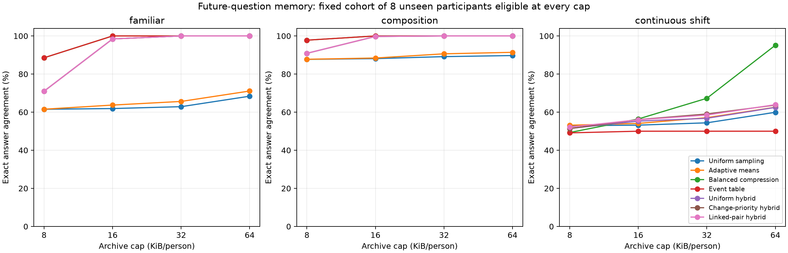

# Future-question sensor memory: first experiment

**Decision: the tested retention heuristics do not justify an FPGA implementation.** Their small local improvements do not establish a useful frontier beyond the strongest simple alternatives. This is a negative result for the tested mechanisms and feature representation, not a rejection of all future-query memory problems.

Completed November 8, 2026, America/Chicago. This report uses **corrected V2 results**. A seed-handling bug discovered in the final V1 audit was corrected, and every validation and test evaluation was rerun. V1 is preserved and superseded. The correction is explained below.

## What ran

The official [ExtraSensory dataset](https://extrasensory.ucsd.edu/) supplied 377,346 observations from 60 people. We used 36 training participants, 12 for validation, and 12 held out for testing. The test histories contain **82,553 observations**. Recording order, gaps, and missing channel values were preserved.

Every memory received the same compact stream: eight activity-classifier scores and four normalized sensor features, encoded in twelve bytes per observation with a missing-value code. The numerical channels describe phone acceleration variability, watch acceleration variability, gyroscope variability, and audio magnitude. The classifiers and feature normalization were fitted on training people. This is a feature-history experiment; it does not test continuous raw-waveform retention or reproduce SensorQA scores.

The primary panel contains **6,912 distinct structured questions**, 576 per test participant, reused across policies. Questions cover observed-session counts used as duration proxies, episode onsets, simultaneous conditions, directed onset-following, conjunction episodes, changed thresholds, and arbitrary thresholds from 0.2 to 0.8. Questions are hidden from ingestion. A following relation counts an A start with a later B start within 30 minutes, with no intervening recording gap over 90 seconds. These are observational relationships, not causal claims. We do not extrapolate through unobserved time.

Thirteen policies or variants were evaluated at 8, 16, 32, and 64 KiB/person: a recent ring, uniform reservoir, change-priority sampling, dyadic means, adaptive piecewise-constant means, lossless eight-bit block compression, oldest-first progressive compression, balanced progressive compression, compressed one-bit event states, two-bit coarse states, a uniform hybrid, a change-priority hybrid, and a linked-pair hybrid.

The hybrids combine a coarse state history with full feature records. Their decoder refines each channel using nearby retained records with the same coarse state. The change-priority version favors simultaneous changes across channels. The pair version retains fixed, nonoverlapping adjacent record pairs. Arbitrary overlapping or long-range bundles and joint soft-value decoding are outside this pilot. These are cheap heuristics, not newly trained task-reward models or SVMemAgent reproductions.

Validation selected **Change-priority hybrid** as the primary candidate. All three hybrids used a two-bit base. The change-priority version selected full weight on its multi-channel cue; the linked-pair version selected zero weight on that cue and used ordinary mean change. Both versions remain visible in the results. Simple methods were selected separately by budget using validation loss.

## Main result

The primary error is the participant-average mean of `abs(answer - reference) / max(reference, 1)`. Lower is better. It is unbounded: false events when the reference is zero can be expensive. Exact agreement and agreement on nonzero answers provide separate checks.

| Cap | Feasible people | Validation-selected simple | Simple error | Uniform hybrid | Change-priority | Linked-pair |
|---|---:|---|---:|---:|---:|---:|
| 8 KiB | 8 | Adaptive means | 0.2454 | 3.4179 | 3.3222 | 3.3752 |
| 16 KiB | 12 | Adaptive means | 0.1977 | 6.2463 | 6.3136 | 6.0407 |
| 32 KiB | 12 | Adaptive means | 0.1415 | 0.1368 | 0.1248 | 0.1290 |
| 64 KiB | 12 | Balanced compression | 0.0051 | 0.0668 | 0.0676 | 0.0619 |

At 32 KiB the primary candidate improves the point estimate over the selected adaptive means, but its error difference is -0.01672, 95% interval [-0.04536, +0.01374]. Its difference from the ordinary uniform hybrid is -0.01199, 95% interval [-0.06411, +0.02920]. Neither comparison establishes a clear advantage with this participant sample.

At 64 KiB, balanced compression is substantially stronger. The primary candidate-minus-balanced error difference is +0.06256, 95% interval [+0.04332, +0.08273]. The primary candidate also does not improve the uniform hybrid on this loss: +0.00083, 95% interval [-0.01126, +0.01384].

The linked-pair mechanism does not rescue the result. Against the uniform hybrid its error difference is -0.00781, 95% interval [-0.02723, +0.00838] at 32 KiB and -0.00490, 95% interval [-0.01204, +0.00137] at 64 KiB. These are participant-cluster bootstrap intervals, not multiple-comparison-corrected significance claims. Random seeds and questions were averaged within participants rather than treated as independent people.

At 64 KiB:

| Method | Exact answers, all questions | Exact when reference is nonzero | Exact, arbitrary thresholds |
|---|---:|---:|---:|
| Balanced compression | 97.3% | 92.4% | 89.1% |
| Uniform hybrid | 82.9% | 55.7% | 60.9% |
| Change-priority hybrid | 83.3% | 56.9% | 62.4% |
| Linked-pair hybrid | 83.4% | 56.6% | 62.6% |

These percentages describe agreement with complete canonical feature history. They are not accuracy against human activity truth. There is no demonstrated roughly 20% storage-efficiency advantage or repeatable cross-budget improvement over the simple frontier.

## What this says about the proposed niche

The compressed one-bit event table answered **100% of familiar and held-out-composition questions at 32 KiB**, on all twelve participants. Those questions use threshold 0.5. Retaining the event-state history already retains order and temporal relationships. A new combination of known predicates does not necessarily require a special relational memory.

Changing predicate thresholds is harder because coarse states discard information needed for reinterpretation. Balanced numerical compression retains that information much more effectively at the larger budget than these selection heuristics. The immediate tradeoff is precision and history coverage. The tested pair mechanism does not create a defensible new capability.

Some small-cap block archives evict older history and use the same fixed training prior for uncovered rows. Thresholding that prior can create many false events; this explains several large normalized errors. Adaptive means spreads its approximation over history and avoids those failures. The outcome depends on the metric: a method can answer many zero-valued queries exactly while making expensive errors on a few other queries. Both views are reported.

## Check without activity-recognition errors

The upstream activity models were weak for several classes. Test participant-average F1 was approximately 0.807 for lying, 0.759 for sitting, 0.353 for walking, 0.073 for running, and zero for eating. The complete-history semantic pipeline therefore does not establish useful human activity QA.

We ran an **explicitly exploratory sensor-only panel after memory creation**: 320 questions per participant, using only the four directly observed normalized numerical channels. It includes conjunctions and onset-following at fixed and arbitrary thresholds. Every answer used the same frozen archives; no policy, parameter, or model was changed for this panel.

At 64 KiB:

| Method | Sensor-only normalized error | Sensor-only exact agreement |
|---|---:|---:|
| Balanced compression | 0.0084 | 89.9% |
| Uniform hybrid | 0.0410 | 66.6% |
| Change-priority hybrid | 0.0321 | 67.2% |
| Linked-pair hybrid | 0.0303 | 67.0% |

The qualitative result survives without activity classifiers. There are some local gains over the uniform hybrid, but balanced compression remains stronger at the larger cap. This is a sensitivity check on the same dataset, not an independently collected second domain or a confirmatory sample. Full per-budget results and comparison intervals are retained.

## Verification and limits

**924 feasible test archives** were reloaded from bytes, checked against their hashes and caps, and used to reproduce all logged answers. An independent loop-based query implementation agreed with all 6,912 primary reference answers. **21 harness tests** passed, including codec losslessness, missingness, epoch precision, gaps, onset boundaries, causal prefixes, archive limits, and repeated calls to a parallel worker.

The archive cap includes timeline and gap encoding, compression framing, values, indices, priorities, and a 64-byte ingestion-state allowance. Four people could not fit their exact timeline at 8 KiB and are explicit infeasible cases. Tables show the feasible count per cap. The plot holds the same eight-person eligible cohort fixed across budgets:

The fixed input chunk is 2 KiB. Shared models, Python object overhead, and query-time decode workspace are outside the archive cap. The shared classifier artifact is about 203 MB. No whole-RAM, power, embedded latency, or FPGA advantage is claimed. Ingestion decisions occur at boundaries of up to 128 observed records; immediate mid-chunk querying is not tested.

Other limits are material. The twelve retained channels are fixed before collection, so new concepts requiring a different encoder are untested. About 63% of primary reference answers are zero; nonzero-answer scores and the sensor-only panel guard against a trivial always-zero interpretation. Quantization alone gives 84.2% exact agreement with unquantized feature answers but only 0.00644 normalized error, showing why exact agreement should be read with an error metric. Questions are generated and structured on one public feature dataset. Human-authored questions, raw high-rate relationships, stronger learned policies, and optimal timeline codecs remain outside the evidence.

## Corrections and reproducibility

Before the initial held-out evaluation, validation exposed extra codec rounding and a capacity edge case; both were corrected, and arbitrary thresholds were added to avoid a quantization-grid coincidence. The protocol records those amendments.

The final V1 audit then found that reused worker processes accumulated participant seed offsets. This changed some generated question sets. We corrected the worker to reset from an immutable base seed and reran **all validation and test evaluations** in V2. The data split, retention algorithms, parameter search, loss, budgets, and selection rule were unchanged. Shared training artifacts were reused. V1 results had been inspected, so V2 is an implementation correction on the same participants, not a new independent confirmatory experiment. V1 is preserved and superseded.

The corrected audit checks every test question set against the serial seed formula. Validation question sets are checked independently as well. The fixed pilot code matches its V2 freeze and validation selection. V2 logs completed without interrupted recovery.

## Decision

I would stop these retention heuristics before FPGA implementation. They do not establish a contribution beyond strong simple alternatives. The experiment also shows why the original argument was insufficient: relational questions over already-computed event states can be cheap to preserve.

A sharper follow-up would need future concepts or measurements absent from the collection-time representation, evidence of irreversible signal loss, and a second domain. It would then need to beat a compact numerical archive and a simple hybrid. This pilot does not supply that evidence.

## Artifacts

- [Protocol and reproduction instructions](../../experiments/future_sensor_memory/README.md), [frozen protocol](../../experiments/future_sensor_memory/PROTOCOL.md).
- [Primary summary](../../results/research/future_sensor_memory/pilot_v2/summary.json), [selected-simple comparison](../../results/research/future_sensor_memory/pilot_v2/paired.json), [uniform-hybrid comparison](../../results/research/future_sensor_memory/pilot_v2/paired_uniform_hybrid.json), and [linked-pair comparison](../../results/research/future_sensor_memory/pilot_v2/paired_linked_uniform.json).
- [Sensor-only summary](../../results/research/future_sensor_memory/pilot_v2/exploratory_numeric_summary.json), [its primary-candidate intervals](../../results/research/future_sensor_memory/pilot_v2/exploratory_numeric_paired_uniform.json), and [its linked-pair intervals](../../results/research/future_sensor_memory/pilot_v2/exploratory_numeric_linked_uniform.json).
- [Training/data manifest](../../results/research/future_sensor_memory/pilot_v2/manifest.json), [V2 revision](../../results/research/future_sensor_memory/pilot_v2/revision.json), [freeze](../../results/research/future_sensor_memory/pilot_v2/protocol_freeze.json), [selection](../../results/research/future_sensor_memory/pilot_v2/selection.json), [completed receipt](../../results/research/future_sensor_memory/pilot_v2/completed.json), [21-test receipt](../../results/research/future_sensor_memory/pilot_v2/tests.xml), and [archive/oracle audit](../../results/research/future_sensor_memory/pilot_v2/audit.json).
- Participant questions, logged answers, serialized memories, and the fixed-cohort plot data are saved alongside these receipts.
