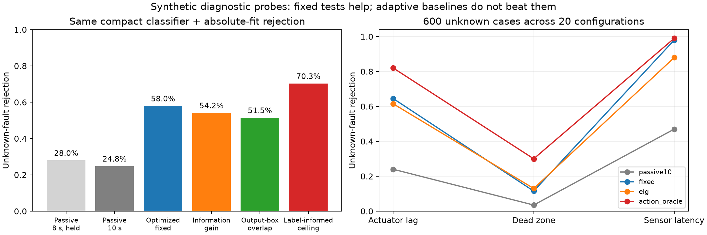

# Diagnostic probes: fixed tests help, adaptive selection remains unproven

November 16, 2026. Completed synthetic software experiment; no new learned
selector, physical robot trial, or FPGA implementation.

## Decision

There is a substantial benefit from acquiring a physical response. The optimized
fixed probe reaches **58.0% unknown-mechanism rejection**, versus **28.0% for the
strongest frozen passive comparator**. That comparator decides at second 8 and
can simply retain its decision; another two seconds of passive observation
achieves only 24.8%. The model family and absolute model-fit rejection rule are
the same. Fixed probing has **95.0% known-fault macro recall** and **3.0% healthy
false alarms**. The paired improvement over the ten-second passive comparator
is 33.2 points, with a descriptive configuration-bootstrap interval of [27.0, 39.3];
the improvement over the stronger eight-second/held result is 30.0 points
([23.7, 36.3]).

There is **no demonstrated adaptive-policy contribution**. Approximate Bayesian
information gain reaches 54.2%, output-box overlap 51.5%, and the fixed
persistent-excitation sequence 55.5%. Information gain is 3.8 points below the
optimized fixed probe, with a paired interval of [−6.8, −0.8].

Unlike the closed memory branch, this study does retain a modest measurable
opportunity: the same-decoder label-informed action ceiling reaches **70.3%**,
12.3 points above the fixed probe ([9.3, 15.2]). The nominal predeclared
opportunity gate passes. The 95% interval does not establish that the population
gap is at least the practical 10-point threshold. Exploratory noise checks
support some stable action-dependent opportunity, while also showing that an
oracle can overfit future measurement noise.

**Recommended next step:** compare existing model-adequacy/robust experiment-design
methods against the frozen fixed-probe baseline. Do not invent an RL/LLM policy
or build FPGA logic yet. A positive ceiling is an upper bound, not an achieved
algorithm or novelty result. The current evidence justifies a bounded existing-method
comparison, not a new-method development program or a publication claim.

## What ran

The [proposal](../../experiments/catalog_validation/PROTOCOL.md) was completed by
a [run specification](../../experiments/catalog_validation/RUN_SPEC.md) and frozen
executable source before final-panel generation at **23:35:07 UTC**. The primary
evaluation completed at **23:36:03 UTC**. Source hashes, fitted decoders,
rejection thresholds and validation-selected probes remained unchanged.

Use a 50 Hz unicycle simulator. Each episode includes 4 seconds of healthy
commissioning, a possible change at second 4, passive observation through
second 8, and at most two one-second probe slots. A fair passive comparator
continues ordinary commands until second 10. Nine ramped velocity/turn targets
provide 81 two-slot sequences. Every sequence and every one-slot probe is
searched on source validation. The classifier and probe selectors receive only
observed pose/commands, never true state, mechanism labels or an unchosen branch.

There are 12 source-training configurations, 8 source-validation configurations,
and **20 unseen final configurations**. The final panel has **1,400 episodes**:
200 healthy, 600 known faults and 600 unknown mechanisms, with ten replicates
per mechanism/configuration. Chassis gains, trajectory, noise scales and noise
correlation vary by configuration. Statistical intervals resample configurations,
not 50 Hz observations or individual windows.

Known modes are healthy, command-axis gain loss, turning-command bias and a
position-sensor offset beginning after commissioning. Final unknown mechanisms
are actuator lag, translational dead zone and pose-reporting latency. Their
episodes never fit baseline classifiers, likelihood templates, scalers,
thresholds or probe choices. Source validation includes two disclosed proxy
unknowns—quantization and periodically held measurements. Held measurements
and latency are related timing corruptions; this is not a claim about
completely uninformed discovery of arbitrary unknown physics.

All interventions and counterfactuals are simulated. Complete branches are
available only to the evaluator and the explicitly cheating ceilings. They are
not measurements from a robot or from the earlier sensor datasets.

## Primary results

The strongest frozen decoder is ExtraTrees on broad response features, with
absolute fit against the known kinematic model bank for rejection. The bank
profiles least-squares gains, bias and sensor offset; its healthy-model margin
and rejection thresholds are calibrated on source validation. Percentages below
are means across the 20 configurations. All rows in this table meet the final
operating constraints of ≥90% known-fault macro recall and ≤5% healthy false alarms.

| Evidence/selection policy | Unknown rejection | Known-fault recall | Healthy false alarms |
|---|---:|---:|---:|
| Passive, 8 seconds | 28.0% | 93.7% | 3.0% |
| Passive, 10 seconds | 24.8% | 95.0% | 3.0% |
| Optimized fixed, one-second probe | 52.3% | 94.5% | 3.0% |
| Optimized fixed, two-second probe | **58.0%** | **95.0%** | **3.0%** |
| Fixed persistent excitation | 55.5% | 94.3% | 4.0% |
| Approximate information gain | 54.2% | 94.2% | 3.5% |
| Output-box overlap | 51.5% | 94.2% | 3.0% |
| Random seeds 0 / 1 / 2 | 43.2% / 44.5% / 46.3% | 94.8% / 95.2% / 94.8% | 3.5% / 2.0% / 2.5% |
| Label-informed action ceiling, not deployable | **70.3%** | 95.7% | 1.0% |

The source-selected two-slot fixed sequence is `(v=0.25, omega=−0.5)` followed
by `(0.25,+0.5)`, with the declared ramps and supervisor. Even selecting the
best universal fixed pair with forbidden hindsight on the final panel yields
only 59.0% rejection, versus 58.0% for source selection. Thus the observed
ceiling gap is not primarily a poor source choice of a universal fixed pair.
The hindsight pair is descriptive and was not adopted as a deployable policy.

The separate gray-box decoder's optimized fixed probe reaches 44.0% rejection
(97.0% known recall, 2.5% healthy false alarms); its persistent-excitation
control reaches 44.8% (97.7%, 4.0%). A compact classifier with nearest-neighbor
novelty rejection is weaker: its fixed probe reaches 13.5% (96.5%, 2.5%). All
33 primary decoder/policy combinations, including failed operating constraints,
are retained in [the summary](../../results/research/catalog_validation/pilot_v1/summary.json).

| Unknown mechanism, 200 cases each | Passive 10 s | Optimized fixed | Information gain | Action ceiling |
|---|---:|---:|---:|---:|
| Actuator lag | 24.0% | 64.5% | 61.5% | 82.0% |
| Dead zone | 3.5% | 11.5% | 13.0% | 30.0% |
| Sensor latency | 47.0% | 98.0% | 88.0% | 99.0% |

The remaining primary headroom is on lag (+17.5 points) and dead zone (+18.5),
not latency (+1). Dead-zone behavior remains particularly hard for the incomplete
bank at this horizon, even with the oracle selecting the probe. The primary
ceiling is better than the fixed probe on 19 of 20 configurations and tied on
one. It uses the same decoder, observation channels and allowed action menu,
but knows the final answer and all counterfactual outcomes. It cannot establish
that the useful action is inferable from the pre-probe evidence.

## Feasibility and reference qualification

The deliberately unfair identifiability reference uses all mechanism families
in source training, broad response traces, and eight seconds of probing
(16-second total horizon). Source validation selects an RBF SVM and threshold.
It achieves **98.5% known-versus-unknown accuracy**, 99.0% known acceptance and
97.8% unknown rejection on final configurations. It passes the proposed 90%
feasibility gate. Its extra knowledge/time must not be compared as an achieved
policy advantage, and it does not prove equal-budget identifiability or unique
physical-cause recovery.

Before this study, the author's unmodified two-second unicycle separating-input
example was executed from [Ni et al.'s public implementation](https://github.com/gtfactslab/Ni_RAL2026)
at commit `19ef5d0032b866330ac998f0096cebedee671315`. All three final output-box
pair overlaps were zero. The shorter 1.2-second refined example retained
nonzero overlap. These are example executions, not replications of the paper's
hardware studies or runtime claims. The pinned immrax release was recovered
from author source history because version 0.1.0 was unavailable on PyPI;
the isolated environment and Windows monitoring adapter are disclosed in
[the reproduction notes](../../experiments/catalog_validation/README.md).

## Post-result stress checks, explicitly exploratory

These checks were added after seeing the primary comparison. The original
frozen result was not replaced or retuned.

**A simpler alarm must have a chance to close the gap.** Add recent-residual and
worst-window residual rejection using existing features and the frozen classifier.
Their thresholds and fixed probes are selected solely on source validation,
with a separate receipt written before supplementary final-panel evaluation.
The best observed deployable result among these controls is fixed persistent
excitation with worst-window residual rejection: **58.8%** unknown rejection,
95.5% known recall and 4.0% healthy false alarms. It does not transform the
achievable frontier. Their label-informed ceilings are much larger (91–92%),
showing that ceilings are decoder-dependent and can be optimistic. These
post-result controls are not claimed as a preregistered discovery or a new method.

**Do oracle-selected probes survive new future noise?** Repeat each final
episode with two independent noise continuations after second 8. Preserve the
underlying mechanism, severity, configuration and the complete observed prefix.
Do not refit the primary models or choose new thresholds.

- The frozen fixed probe averages **57.2%** rejection over the two continuations,
  with 94.8% known recall and 4.0% healthy false alarms.
- Replaying the original oracle's arbitrary *first-success* choice yields
  only **52.8%**. Treating that tie-break alone as evidence for stable headroom
  would be misleading.
- Choosing the most strongly supported correct oracle outcome on the original
  noise, then transferring that choice to new noise, yields **66.7%** and
  **68.3%**, versus fixed results of 57.5% and 56.8% in those same replays.
- An additional full-information oracle chooses using the original and first
  noise realizations, then is evaluated on the second independent continuation.
  It reaches **69.0%**, versus **56.8%** fixed, with 96.2% known recall and 2.5%
  healthy false alarms.

Margin-based and noise-averaged oracle choices retain roughly 10–12 points
in these checks. This supports some stable world-dependent action opportunity;
it does not remove the oracle's access to labels and unavailable outcomes.
Only two new disturbance realizations per world were used, on the same 20
configuration clusters. These checks are sensitivity analyses, not independent
replications or a deployable selection algorithm.

## Gates, scope and limitations

The nominal opportunity screen passes: the longer-horizon reference clears
90% accuracy; fixed probing beats passive observation, including retaining
the stronger eight-second decision; the original same-decoder ceiling clears the fixed probe
by over 10 points, including two unknown mechanism families; and known/healthy
constraints are met. No simple policy comes within three points of that ceiling.
The confidence interval and exploratory checks support a cautious next step,
not a guaranteed ≥10-point generalization result. No adaptive method has yet
realized the ceiling gap.

The simulator uses relatively large, declared faults, a healthy commissioning
prefix, a common known change opportunity, simple kinematics and bounded
Gaussian correlated noise. New configurations are independent draws within the
declared envelope, not an unrestricted physical-domain shift. All 1,400 cases
are synthetic. The model bank, Gaussian forecasts, output-box proxy and classifier
are conventional and finite. The output-box selector is not certified nonlinear
reachability. Controller, sensor, wheel-slip and actuator interactions in real
hardware may differ substantially. A failed feasibility classifier would not
have proved an impossibility theorem; a successful one does not prove that a
short-budget monitor has enough information to choose a good test.

No named unknown fault is diagnosed: rejection means that the catalog does not
fit. Matching kinematic gain/radius effects form an algebraic equivalence
control, not an extra empirical fault-class score. No unique physical-component
claim is made where observations cannot distinguish mechanisms.

Primary adaptive information-gain selection took about **11.2 ms total for the
two decisions** on this desktop, excluding decoder evaluation. It was not
benchmarked as an embedded runtime. The serialized three-horizon shared model
bundle is about 3.66 MB; the 10-second bundle is 1.59 MB and includes both
classifier and distance-reference data. These are not FPGA RAM, energy or
sensor power measurements. No true workspace violations were observed in the
primary policy runs; this cannot certify safety for unmodeled physical faults.

Before a new-method contribution, run the closest existing robust design and
model-adequacy approaches identified in the [research screen](2026-11-16-broader-niche-search.md).
If they close the residual, adopt the existing method and stop the novelty claim.
A physical or second-domain replication is still required before hardware work.

## Integrity and artifacts

Twelve harness tests pass. The final audit verifies frozen sources/models and
selection receipts, disjoint configuration partitions, actual intervention
bounds, identical healthy prefixes across mechanism labels, sibling-branch
causality, serial replay of one saved case per configuration, 40 causal selector
replays, and independently recomputed metrics for all **660 primary configuration/
decoder/policy rows**. The complete source/final trace manifest is hash-pinned.
Original reference receipts counted untracked Python caches as an unclean
worktree; an independent tracked-source check confirms the numerical source
was unchanged. This is controlled procedural separation, not external blinding.

Reproduce with [the README](../../experiments/catalog_validation/README.md).
Results: [primary summary](../../results/research/catalog_validation/pilot_v1/summary.json),
[per-mechanism scores](../../results/research/catalog_validation/pilot_v1/by_mechanism.json),
[paired configuration comparisons](../../results/research/catalog_validation/pilot_v1/paired_comparisons.json),
[final audit](../../results/research/catalog_validation/pilot_v1/final_audit.json),
[freeze](../../results/research/catalog_validation/pilot_v1/freeze.json),
[reference result](../../results/research/catalog_validation/pilot_v1/oracle/result.json),
[supplemental baselines](../../results/research/catalog_validation/pilot_v1/supplement/results.json),
[noise transfer](../../results/research/catalog_validation/pilot_v1/supplement/noise_transfer.json),
and [oracle tie sensitivity](../../results/research/catalog_validation/pilot_v1/supplement/margin_sensitivity.json).
