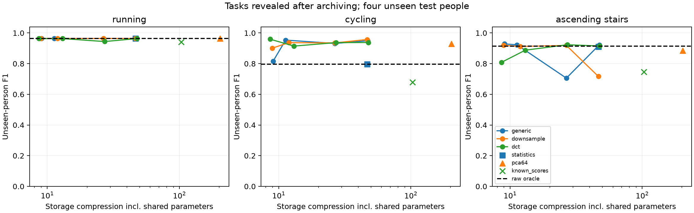

# Retroactive sensor-task learning: simple archives leave no useful gap

November 16, 2026. Completed software feasibility experiment; no new retention method or FPGA implementation.

## Decision

Do not build another future-question memory method for this workload. Categories absent from collection-time model fitting remain learnable from ordinary compressed waveforms and broad frozen features. On the primary running task, a task-blind archive capped at 1 KiB per 5.12-second window produces the same test classifications as the full float32 history at **47.3× less storage**. On ascending stairs, it slightly exceeds the raw reference's mean F1. A plain fixed feature bank also matches running and stays within 0.003 F1 on stairs at 46.6× compression.

This is a negative feasibility screen for the proposed contribution, not a general impossibility result. It closes the current activity-memory branch under the predeclared decision rule. There is no evidence here that a novel method would provide useful value beyond the simple baselines.

## Design and separation of collection from future tasks

The [frozen protocol](../../experiments/retroactive_task/PROTOCOL.md) specifies the tasks, split, codecs, learner choices and decision rules before collection. Use [PAMAP2's official protocol recordings](https://archive.ics.uci.edu/dataset/231/pamap2+physical+activity+monitoring), subjects 101–108. Running (5) is the primary withheld category; cycling (6) and ascending stairs (12) are secondary. Subject 109 was excluded in advance because of its short, incomplete protocol coverage.

Collection-time PCA, known-class classifier and normalization use only subjects 101–104 and windows containing **no samples** from any withheld category. This includes excluding a window if even a minority of its samples belongs to a future category. There are 1,444 eligible collection-training windows from nine remaining classes. The encoders can still encounter withheld-category waveforms as unlabeled signals during collection. Their interfaces receive no future labels.

Every complete, nonoverlapping 512-sample window is archived: 5,589 windows of 18 accelerometer/gyroscope channels from hand, chest and ankle at 100 Hz. Missing values are interpolated only within the current window; waveform archives preserve the missingness mask. Windows with ambiguous labels or transitions are retained in storage. Only evaluation filters to nonzero activity labels with at least 95% purity and valid timing: 3,684 windows remain, with 1,751 for post-reveal training and 1,933 for testing. Thus 1,905 archived windows are excluded from scoring, not from the storage denominator.

The collection stage closes all 160 files across 20 representations, then writes their SHA256 manifest. The manifest was committed at **18:55:30 UTC**, the first all-frame audit completed at **18:57:10 UTC**, and future labels were released to the learning stage at **18:57:19 UTC**. All downstream models train after that receipt. Collection and evaluation use the same frozen study source and protocol hashes. The collection parameters and archive hashes remain unchanged.

After release, fit a new binary detector per category using archived subjects 101–104. Subjects 105–108 are unseen-person tests. Choose ExtraTrees versus standardized RBF SVM, a small threshold grid, and available feature choices using leave-one-training-person-out validation only. Waveform archives allow new statistics and phase-preserving DCT features to be computed after release; feature-only archives expose only their stored vectors. The raw reference receives both feature choices. Test labels never choose models or thresholds.

This is a single-machine procedural separation, not third-party blinding or secure isolation. The custodian knows the category IDs to exclude them from collection fitting. It tests later supervised learning of held-out categories, not label-free open-world discovery.

## Baselines and storage accounting

All codecs are conventional. Waveform baselines combine anti-aliased downsampling or truncated orthonormal DCT with 4/8-bit affine quantization or float16 and standard zlib compression. Within each family, choose the current window's configuration by task-blind normalized reconstruction MSE under a 1/2/4/8 KiB frame cap. The generic baseline chooses between these two families by the same criterion. It is a strong baseline assembled from existing ingredients, not a proposed research method.

Other controls are full float32, reversible zlib/LZMA compression with optional temporal XOR and byte shuffle, a 378-dimensional fixed statistics/spectral bank in float16, PCA16/32/64 fitted on the known-class bank, and the known-class classifier's frozen posterior scores. Posterior-only storage is deliberately task-specific and cannot establish a contribution if it loses information.

Reported compression is full float32 archive bytes divided by complete encoded history bytes plus separately stored shared parameters. It includes frame lengths, headers, start times, sample rates, masks and codec parameters. The 8-byte history header is additional to each per-window cap. No memory capacity, energy, throughput or FPGA cost is inferred. Full float32 history is 206.393 MB; generic 1 KiB history plus shared parameters is 4.361 MB. Decoder/extractor program code is excluded from all dataset payload totals. Losslessness is relative to the selected float32 inputs, not the source decimal text.

## Results

Numbers are unweighted mean F1 over four test people. Compression ratios include shared model bytes.

| Archive | Compression | Running | Cycling | Ascending stairs |
|---|---:|---:|---:|---:|
| Full float32 reference | 1.0× | 0.9633 | 0.7973 | 0.9132 |
| Lossless zlib | 1.2× | 0.9633 | 0.7973 | 0.9132 |
| Lossless LZMA | 1.3× | 0.9633 | 0.7973 | 0.9132 |
| DCT, 1 KiB cap | 47.7× | 0.9633 | 0.9380 | 0.9151 |
| Downsample, 1 KiB cap | 46.6× | 0.9633 | 0.9574 | 0.7165 |
| Generic, 1 KiB cap | 47.3× | 0.9633 | 0.9496 | 0.9223 |
| DCT, 2 KiB cap | 27.1× | 0.9442 | 0.9372 | 0.9232 |
| Downsample, 2 KiB cap | 26.7× | 0.9633 | 0.9353 | 0.9189 |
| Generic, 2 KiB cap | 26.7× | 0.9633 | 0.9316 | 0.7056 |
| DCT, 4 KiB cap | 13.0× | 0.9633 | 0.9145 | 0.8879 |
| Downsample, 4 KiB cap | 11.9× | 0.9633 | 0.9369 | 0.9120 |
| Generic, 4 KiB cap | 11.3× | 0.9633 | 0.9535 | 0.9227 |
| DCT, 8 KiB cap | 8.6× | 0.9633 | 0.9595 | 0.8087 |
| Downsample, 8 KiB cap | 8.9× | 0.9633 | 0.9011 | 0.9193 |
| Generic, 8 KiB cap | 9.1× | 0.9633 | 0.8153 | 0.9287 |
| Fixed statistics/spectral bank | 46.6× | 0.9633 | 0.7973 | 0.9103 |
| Frozen PCA16 | 503.6× | 0.9284 | 0.9015 | 0.7736 |
| Frozen PCA32 | 336.8× | 0.7071 | 0.8828 | 0.8096 |
| Frozen PCA64 | 202.6× | 0.9633 | 0.9288 | 0.8854 |
| Frozen known-class scores | 103.2× | 0.9413 | 0.6786 | 0.7457 |

The raw reference passes the predeclared 0.85 F1 and balanced-accuracy gates for running (0.9633 F1, 0.9655 balanced accuracy) and stairs (0.9132, 0.9422). Cycling fails both gates (0.7973, 0.8354), so it is **inconclusive for attributing error to memory loss**. Its raw average precision is much higher (0.9702), suggesting the selected operating point/generalization deserves scrutiny. We leave the frozen learner/threshold grid unchanged. Compressed cycling outperforming raw is an observed finite-classifier result, not proof of information creation or of a better general representation.

The generic 1 KiB baseline has a running F1 difference of exactly zero for every test person. Its stairs mean difference is +0.0092, with mixed individual differences. The feature bank's stairs difference is −0.0029. Both comfortably meet the predefined mean-F1 proximity screen without a new method.

| Test subject | Raw running | Generic 1 KiB running | Raw stairs | Generic 1 KiB stairs |
|---|---:|---:|---:|---:|
| 105 | 0.9892 | 0.9892 | 0.9434 | 0.9630 |
| 106 | 0.9882 | 0.9882 | 0.9200 | 0.8519 |
| 107 | 0.9091 | 0.9091 | 0.9688 | 0.9697 |
| 108 | 0.9667 | 0.9667 | 0.8205 | 0.9048 |

There is a real individual stairs regression on subject 106 despite the favorable average. Four participants cannot establish equivalence or broad guarantees: the exploratory participant bootstrap interval for generic-minus-raw stairs F1 is approximately [−0.046, +0.063]. The zero observed running differences also do not imply zero population uncertainty. The conclusion is that this screen provides no demonstrated gap, not that every future task is preserved.

## What this changes in the research argument

Failure of narrow task outputs is insufficient. Known-class scores perform poorly on stairs, yet a broad feature bank and ordinary waveform compression preserve it. Likewise, downsampling alone loses stairs at 1 KiB while DCT at the same cap does not. A weak-baseline comparison would manufacture an apparent niche.

Accuracy is not monotonic in reconstruction MSE, cap, or PCA dimension. Generic 2 KiB has poor stairs F1 despite generic 1 KiB doing well; PCA32 loses running while PCA16 and PCA64 do better. The codecs optimize signal error and the classifiers are finite, so these curves are not information-theoretic limits. There may be questions about task-aware distortion or robust operating points, but this run does not make either a novel contribution: cheaper fixed archives already solve the learnable tasks. Do not treat these isolated nonmonotonic points as a reason to build a method.

The reasonable action is to retain this as negative evidence and stop implementation on this branch. Reopen it only for a separately motivated application with a genuinely necessary future task, a successful raw reference, and an independently demonstrated failure of strong simple archives at a meaningful deployment budget. Do not keep changing tasks or tightening budgets merely to obtain a gap. A later positive screen would still need another domain and comparison with stronger learned storage such as [CHORD](https://arxiv.org/abs/2611.11913), which was not reproduced here.

## Limitations and verification

Eight people supply recordings; only four supply unseen-person evaluation. Running has just 58 positive training windows from two people and 127 positive test windows. Two training validation folds have no positive running examples and therefore contribute zero F1 for every configuration; the nominal validation mean has a 0.5 ceiling. Cycling has three positive training people, and stairs four. These coverage limits weaken generalization and model selection, although they do not explain away the strong simple-baseline result on the fixed test split. Subject 107 has only six positive running test windows.

The categories are known to the custodian, post-reveal supervised labels are available for historical training data, and evaluation uses a fixed closed-world activity set. This does not test unseen fault physics, causality, arbitrary queries, much longer horizons, every subject split, deployment drift, or highly transient/high-frequency future tasks. The broad feature bank was specified with general activity-recognition knowledge, not learned from hidden category labels. The fitted embeddings are ordinary PCA, not foundation-model embeddings or learned neural codecs. Model family/feature/threshold selection can produce unstable test differences; no test-driven revisions were made.

The 12 harness tests pass. The final audit rechecks all 111,780 stored frames, counts, timestamps, masks, cap compliance, exact raw/lossless reconstruction, model hashes, unchanged frozen source/protocol, train/test separation and reveal chronology. Raw, zlib and LZMA produce bit-identical saved prediction arrays and scores for all three tasks. A separate metric audit verifies saved predictions against the label vault, threshold decisions, training-validation selection, and 240 person-level F1/balanced-accuracy pairs. There were no analysis changes to the frozen study code or protocol after reveal. An audit-only performance fix cached each source NPZ once instead of repeatedly decompressing it; this changed neither archive construction nor evaluation.

Artifacts: [reproduction instructions](../../experiments/retroactive_task/README.md), [study implementation](../../experiments/retroactive_task/study.py), [all metrics and validation selections](../../results/research/retroactive_task/pilot_v1/results.json), [storage accounting](../../results/research/retroactive_task/pilot_v1/storage_quality.json), [class counts](../../results/research/retroactive_task/pilot_v1/post_reveal_class_counts.json), [paired participant differences](../../results/research/retroactive_task/pilot_v1/paired_oracle.json), [archive manifest](../../results/research/retroactive_task/pilot_v1/archive_commit.json), [final integrity audit](../../results/research/retroactive_task/pilot_v1/final_audit.json), [metric audit](../../results/research/retroactive_task/pilot_v1/metric_audit.json), and [test receipt](../../results/research/retroactive_task/pilot_v1/tests.xml). Binary archives and original data remain locally available; large reproducible archives are excluded from git.

Dataset attribution: Reiss and Stricker, PAMAP2 Physical Activity Monitoring, UCI, [DOI 10.24432/C5NW2H](https://doi.org/10.24432/C5NW2H), CC BY 4.0. The ZIP hash and source URL are recorded in the run's source receipt.
